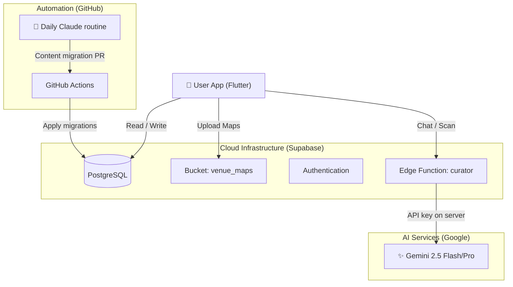
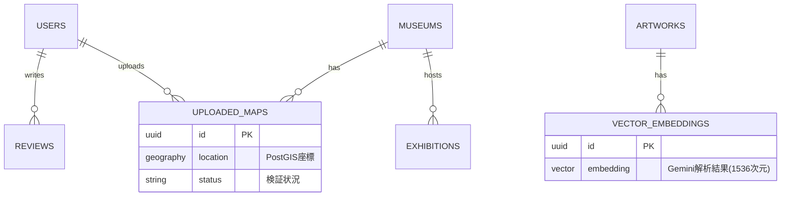

# EnCura (エンキュラ) - AI Museum Guide 🏛️


<p align="center">
  
</p>

<p align="center">
  <b>「専属AI学芸員と歩く、次世代の美術館体験」</b><br>
  AI-Powered Museum Companion App built with Flutter & Gemini 2.5
</p>

<p align="center">
  
  
  
  
</p>

---

## 📖 概要 (Overview)

**EnCura** は、美術館での鑑賞体験をAI技術で拡張するモバイルアプリケーションです。
単なる音声ガイドではありません。カメラで作品を認識して解説するだけでなく、**「トイレはどこ？」といった館内案内から、「この絵の背景は？」という深い美術談義まで**、専属のAI学芸員が24時間対話形式でサポートします。

また、**毎日動く Claude の定期実行** が展覧会・今日の一枚・美術ニュースを調べ、公式の出典で確かめられたものだけを、日時入りの SQL マイグレーションとして CI が DB に反映します。

## ✨ 主な機能 (Key Features)

### 1. 🤖 Anytime Curator (AI学芸員)
* **概要:** 美術・歴史・文化に特化したAIチャットボット。
* **技術:** `Gemini 2.5 Flash` を使用。システムプロンプトによる厳格なドメイン制御（美術以外の話題拒否）と、過去の会話履歴を記憶するコンテキスト管理を実装。

### 2. 📷 Scan & Guide (作品認識解説)
* **概要:** 展示作品や手元の図録をカメラでスキャンすると、AIが即座に解説。
* **技術:** `Gemini Vision` によるマルチモーダル解析。画像を1024pxに圧縮して高速送信する最適化済み。

### 3. 🗺️ AI Map Memory (みんなのマップ)
* **概要:** ユーザーが撮影した「館内図」をAIが自動検証・データベース化するUGC機能。
* **技術:** 画像が「地図」であるかをAIが判定し、Supabase Storageへ自動アップロード。これにより、公式マップデータがない美術館でもナビゲーションが可能に。

### 4. 📰 Auto Event Hunter (完全自動収集)
* **概要:** 毎日朝9時に、日本国内の展覧会情報を自動収集・更新。
* **技術:** Claude の定期実行が候補を集め、`scripts/content/build_migration.py` が公式ページの確認・会場の住所の座標化（国土地理院）・作品画像の確認（Wikidata）を行い、`supabase/migrations/` に日時入りのマイグレーションを書く。GitHub Actions が `PostGIS` 対応の DB に反映。

### 5. 🎨 Today's Art & Trends
* **概要:** 毎日更新される名画コラムと、SNSで話題のアートトピック配信。
* **技術:** バッチ処理によるコンテンツ自動生成。

---

## 🛠 技術スタック (Tech Stack)

モダンかつスケーラブルな構成を採用しています。

| Category | Technology | Usage |
| :--- | :--- | :--- |
| **Frontend** | **Flutter** (Dart) | クロスプラットフォーム開発 (iOS/Android) |
| **Backend** | **Supabase** | BaaS (Auth, Database, Edge Functions, Storage) |
| **Database** | **PostgreSQL** | `PostGIS` (位置情報), `pgvector` (AI検索用) |
| **AI Model** | **Google Gemini 2.5** | Flash (リアルタイム応答), Pro (バッチ処理) |
| **DevOps** | **GitHub Actions** | DB マイグレーション、点検、TestFlight、CI |
| **Development** | **AI-Assisted** | Gemini 2.5のコード生成を活用し、**コアロジック（クローラーや位置情報処理）の実装に人間のリソースを集中** |

---

## 🏗️ アーキテクチャ (Architecture)

### 📂 ディレクトリ構成 (Directory Structure)
モノレポ構成を採用し、フロントエンド・バックエンド・マイクロサービスを一元管理しています。

```text
encura/
├── .github/workflows/       # CI、DB マイグレーション、点検、TestFlight
├── lib/                     # Flutter アプリ
│   ├── core/                # 設定・サービス・リポジトリ・モデル
│   └── ui/                  # 画面とウィジェット
├── test/                    # Flutter のテスト
├── scripts/
│   ├── content/             # 毎日のコンテンツを確かめてマイグレーションにする
│   ├── health_check.py      # 外部依存の点検
│   └── ios/archive.sh       # iOS のアーカイブと TestFlight へのアップロード
├── supabase/
│   ├── functions/curator/   # Gemini を呼ぶ Edge Function (TypeScript/Deno)
│   └── migrations/          # スキーマとコンテンツ（日時入りのマイグレーション）
└── docs/                    # 診断・リリース手順・毎日のコンテンツ更新の手順
```



### 📷 写真の扱い
Scan & Guide の写真は、撮った時点で端末の中で縮小（1024px）・圧縮してから、AI 学芸員の関数に送ります。画像処理用のサーバーは使いません。

### 🗄 データベース設計 (Database Schema)
Supabase (PostgreSQL) 上で、地理空間データ(PostGIS)とベクトルデータ(pgvector)を統合管理しています。



---

## 🧪 品質管理とテスト戦略 (Quality Assurance)
スケーラビリティと保守性を担保するため、以下のテスト戦略を採用しています。

| Layer | Technology | Scope |
|:---|:---|:---|
| **Unit Test** | `flutter_test` | ViewModel, Repository層のロジック検証 |
| **E2E** | Manual / Maestro | 実機でのUI動作確認 |
| **CI** | GitHub Actions | PR作成時の自動ビルド・Lintチェック |

---

## 🚀 セットアップ (Getting Started)
このリポジトリはポートフォリオ用です。実機で動作させるには以下の環境変数の設定が必要です。

### 1. Prerequisites
Flutter SDK 3.x

Supabase Account

Google AI Studio API Key

### 2. 設定値
アプリに秘密鍵は入れません。Gemini の API キーは Supabase Edge Function（`supabase/functions/curator`）のシークレットにだけ置きます。

アプリ側の設定はビルド時に `--dart-define-from-file` で渡します。

```bash
cp config/prod.example.json config/prod.json   # 値を埋める（config/*.json は git 管理外）
```

| キー | 中身 |
| :--- | :--- |
| `SUPABASE_URL` | Supabase プロジェクトの URL |
| `SUPABASE_ANON_KEY` | Supabase の anon（公開）キー |

Edge Function 側:

```bash
supabase secrets set GEMINI_API_KEY=...   # 値は表示・コミットしない
supabase functions deploy curator
```

### 3. Run
```bash
flutter pub get
flutter run --dart-define-from-file=config/prod.json
```

リリース手順は [docs/RELEASE.md](docs/RELEASE.md) を参照してください。

---
## 👨‍💻 開発者 (Developer)
Enludus (Information Science Student)

Focus: AI-Native App Development, Game Creation

Contact: contact@enludus.com / <https://enludus.com>

<p align="center"> 
    © 2025 Enludus. All rights reserved. 
</p>
